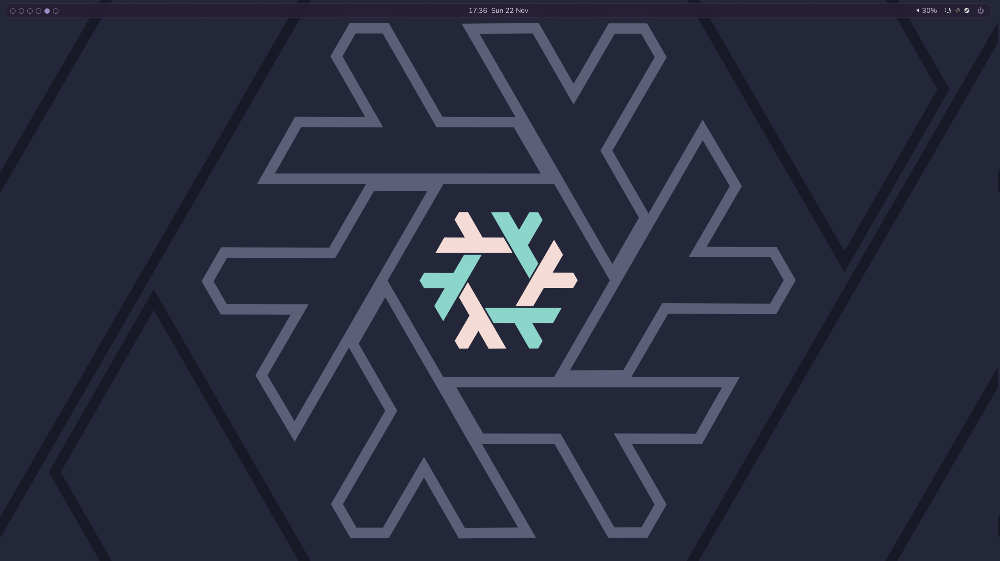
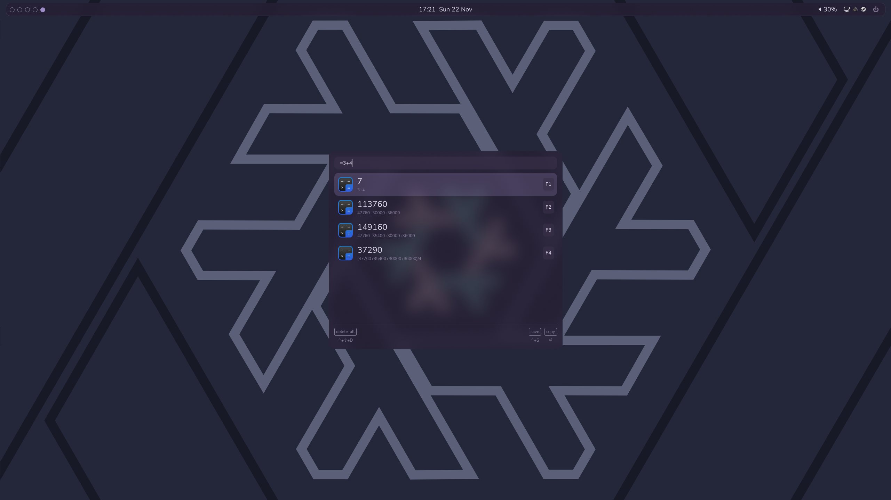
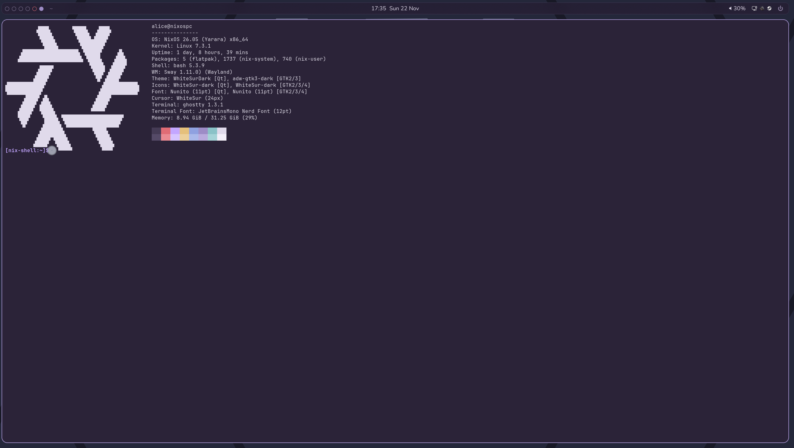
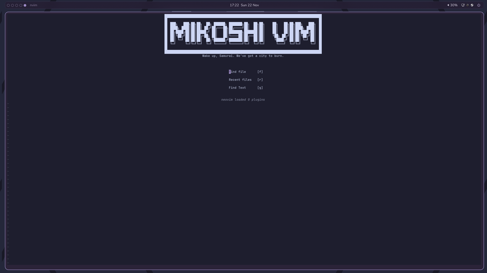

# Mikoshi

> *"Wake up, Samurai. We've got a city to burn."*

A complete, themed NixOS desktop you add to your own flake and switch on piece by piece. Turn on Sway and you get a launcher, bar, notifications, lock screen, login screen, terminal, Neovim and file manager, all matching, without copying any of it into your own config.

<p align="center">
  
  
  
  
</p>

## Getting started

Add mikoshi to your flake, list your users, and enable what you want:

```nix
{
  inputs.mikoshi.url = "github:szewczyk-bartosz/mikoshi";

  outputs = {nixpkgs, mikoshi, ...}: {
    nixosConfigurations.myhost = nixpkgs.lib.nixosSystem {
      system = "x86_64-linux";
      modules = [
        mikoshi.modules.nixos.default
        ./hardware-configuration.nix
        {
          mikoshi.meta.users = ["samurai"];
          mikoshi.wm.sway.enable = true;
          mikoshi.gaming.enable = true;

          users.users.samurai.isNormalUser = true;
          home-manager.users.samurai.home.stateVersion = "26.05";
          system.stateVersion = "26.05";
        }
      ];
    };
  };
}
```

Importing the module only turns on the basics (NetworkManager, garbage collection, neovim, tmux). `mikoshi.wm.sway.enable` brings the whole desktop with it, and you can switch any part back off, e.g. `mikoshi.waybar.enable = false;` if you'd rather use your own bar.

## What you get

### Desktops across every monitor

With several monitors, a desktop covers all of them. `Alt+1` switches *every* monitor to desktop 1, and `Alt+Shift+1` sends the focused window to desktop 1 on the monitor it's already on. `Alt+Tab` flips between your last two desktops. Unplug a monitor and its windows move to the ones that remain; plug it back in and the layout comes back.

Arrange your monitors with `Alt+Shift+D`. Until you do, a notification at login reminds you.

### Laptop friendly

- Closing the lid turns the laptop screen off when you're docked.
- The screen locks after 5 minutes idle, the display turns off after 10, and it always locks before sleep.
- Fullscreen video, games and playing audio keep the screen awake.

### One theme everywhere

Everything shares the same colours: windows, bar, launcher, notifications, lock screen, login screen, GTK and Qt apps, and the terminal. Switch the whole desktop to light mode with:

```nix
mikoshi.theme.polarity = "light";
```

Neovim is the one exception and uses Catppuccin Mocha.

### Custom palettes

Bring your own colours with `mikoshi.meta.palette`. You only need to define the mode you use (dark or light). If a colour is missing, or the mode you've selected isn't defined, your build fails with an error saying what's missing.

```nix
mikoshi.meta.palette.dark = {
  base = "#1e1e2e";      # window and terminal background
  surface = "#262637";   # bars, headers, sidebars
  overlay = "#313244";   # cards and popovers
  subtle = "#45475a";    # borders, inactive elements
  text = "#cdd6f4";
  muted = "#7f849c";     # secondary text
  accent = "#89b4fa";    # focus, cursor, active elements
  border = "#89b4fa";    # focused window borders
  danger = "#f38ba8";
  warning = "#f9e2af";
  highlight = "#45475a"; # selected text
  terminal.normal = {
    green = "#a6e3a1";
    blue = "#89b4fa";
    cyan = "#94e2d5";
  };
};
```

The terminal's other colours are picked from the ones above (red from `danger`, yellow from `warning`, and so on), and the bright terminal colours match the normal ones. Set any of them under `terminal.normal` or `terminal.bright` to choose your own.

To keep a palette in its own file (with `dark`, `light`, or both):

```nix
mikoshi.meta.palette = import ./my-palette.nix;
```

To give just one part of the desktop a different look, set its own `palette`. Everything else keeps the main one:

```nix
mikoshi.regreet.palette = import ./greeter-palette.nix;
```

This works for `appearance`, `ghostty`, `lock`, `regreet`, `swaync`, `walker`, `waybar` and `wm.sway`. Icons follow `mikoshi.theme.polarity`, so set it to match your palette.

## Options

### On by default

| Option | What it does |
|---|---|
| `mikoshi.meta.users` | Who gets the desktop config. **Required.** |
| `mikoshi.meta.keyboardLayouts` | Keyboard layouts (default `["gb"]`). `Super+Space` cycles them |
| `mikoshi.meta.palette` | Colours for the whole desktop; see [Custom palettes](#custom-palettes) |
| `mikoshi.theme.polarity` | `"dark"` (default) or `"light"` |
| `mikoshi.network.enable` | NetworkManager |
| `mikoshi.nixGarbageCollection.enable` | Weekly cleanup of old generations, plus extra cleanup when disk space runs low |
| `mikoshi.nvf.enable` | Neovim, [below](#neovim) |
| `mikoshi.tmux.enable` | tmux with `C-Space` prefix, vi keys and mouse |

### Desktop

| Option | What it does |
|---|---|
| `mikoshi.wm.sway.enable` | The Sway desktop, with blur, rounded corners, screenshots, wallpaper and on-screen volume/brightness. Turns on everything below. Also: `capsAsCtrl`, `wallpaper` (an image, or `null` for a solid colour) |
| `mikoshi.walker.enable` | App launcher. Type `=` for a calculator, `/` for files, `:` for clipboard history |
| `mikoshi.waybar.enable` | Floating bar with desktops, window title, clock, audio and tray. Also: `battery.enable`, `minDesktops` |
| `mikoshi.swaync.enable` | Notification centre with do-not-disturb, volume, brightness and power buttons |
| `mikoshi.lock.enable` | Lock screen with a blurred background and clock, plus idle locking |
| `mikoshi.regreet.enable` | Themed login screen |
| `mikoshi.appearance.enable` | Matching GTK and Qt apps, icons, cursors and UI font |
| `mikoshi.thunar.enable` | Thunar file manager with thumbnails. "Open Terminal Here" opens ghostty |
| `mikoshi.graphical.enable` | Audio, fonts and the ghostty terminal |
| `mikoshi.bluetooth.enable` | Bluetooth with a tray icon |

### Extras

| Option | What it does |
|---|---|
| `mikoshi.gaming.enable` | Steam, Heroic, gamemode and Proton tools. Allows unfree packages |
| `mikoshi.obs-amd.enable` | OBS Studio with hardware encoding. **AMD GPUs only** |
| `mikoshi.bmd.enable` | `bmd` from [engramware](https://github.com/szewczyk-bartosz/engramware) |

### Defaults you might want to change

Set any of these in your own config and your value wins.

| Option | Default |
|---|---|
| `time.timeZone` | `"Europe/London"` |
| `i18n.defaultLocale` | `"en_US.UTF-8"` |
| `console.font` | `"Lat2-Terminus16"` |

## Keybinds

**Alt** is the main modifier. Tap **Super** on its own to open the launcher.

| Key | Action |
|---|---|
| `Super` (tap) | Launcher |
| `Super+L` | Lock |
| `Alt+Return` | Terminal |
| `Alt+Shift+Q` | Close window |
| `Alt+H/J/K/L` or arrows | Focus left / down / up / right |
| `Alt+Shift+H/J/K/L` or arrows | Move window |
| `Alt+1…9, 0` | Switch every monitor to desktop 1–10 |
| `Alt+Shift+1…9, 0` | Send window to desktop 1–10 |
| `Alt+Tab` | Previous desktop |
| `Alt+F` | Fullscreen |
| `Alt+Shift+Space` / `Alt+Space` | Toggle floating / switch focus between tiled and floating |
| `Alt+S` / `Alt+W` / `Alt+E` | Stacking / tabbed / toggle split |
| `Alt+A` | Focus parent |
| `Alt+R` | Resize mode (`H/J/K/L`, `Esc` to leave) |
| `Alt+Shift+S` / `Print` | Screenshot an area / the whole screen, copied and saved to `~/Pictures/Screenshots` |
| `Alt+Shift+D` | Arrange monitors |
| `Alt+Shift+C` / `Alt+Shift+E` | Reload / exit Sway |
| Volume, brightness, media keys | Work as expected, with an on-screen indicator |

## Neovim

Neovim nightly, set as your editor and aliased to `vim`. Leader is **Space**, and a popup shows the available keys as you type.

It comes with fuzzy finding, a file tree, a symbol outline, autocompletion with snippets, git integration (including lazygit in a floating terminal) and a start screen. Language support, with completion, highlighting and formatting, is included for **Nix, Python, Rust, Java, JS/TS/TSX, CSS and HTML**.

For NixOS option completion from any directory, point `mikoshi.nvf.nixdFlake` at your own flake.

| Key | Action |
|---|---|
| `jk` (insert) | Escape |
| `s` | Jump anywhere on screen |
| `<leader>e` / `<leader>lo` | File tree / symbol outline |
| `<F12>` | Floating terminal |
| `<C-h/j/k/l>`, `<leader>sh` / `<leader>sv` | Move between / create splits |
| `<Tab>` / `<S-Tab>`, `<leader>bq` | Next / previous / close buffer |
| `<leader>ld` `lr` `li` `lt` | Definition / references / implementations / type |
| `<leader>ln` `la` `lh` `lf` | Rename / code action / hover / format |
| `<leader>dd` `dn` `dp` | Show / next / previous diagnostic |
| `]c` / `[c`, `<leader>gs` `gp` `gb` | Next / previous change, stage / preview / blame |
| `<leader>gco` `gct` `gcb` `gcn` | Merge conflict: ours / theirs / both / none |

On the start screen: `f` find file, `r` recent files, `g` search in files.

## Roadmap

- Clickable desktops in the bar, plus a keyboard-layout indicator
- Fix windows collapsing onto one monitor after resume
- Make the OBS option work on any GPU
- A tidier home directory
- Move the Neovim config from nvf to nixvim

## License

[GPL-3.0](LICENSE)
